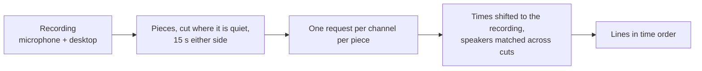

# How it works

Murmur is a GNOME Shell extension, which means it runs inside the compositor itself. There is no daemon, no tray process and no companion service: the shortcuts, the panel, the microphone, the network connection and the insertion are all the same process. Audio is captured and encoded by GStreamer, which the shell already carries, on threads of its own, so none of it runs on the thread that draws the screen.

## One dictation, start to finish

1. **The shortcut fires.** `Super+Space` is a shell keybinding, active in the normal session and in the overview.
2. **The panel opens** at the bottom of the monitor holding the focused window - the pointer's monitor when nothing is focused - clear of anything docked there, showing the status, the level of your voice, a countdown, the destination, and the transcription as it arrives, alongside an indicator in the top bar. Nothing is grabbed: the panel is drawn as shell chrome and, unless it holds the keyboard, every click and keystroke goes where it would have anyway.
3. **The microphone opens.** A GStreamer pipeline captures the default PipeWire source and converts it to 16 kHz, mono, signed 16-bit little-endian. GJS cannot run JavaScript on GStreamer's own threads, so what it has heard is collected from the main loop every 100 ms; until the service is ready it waits in the pipeline, so nothing said meanwhile is lost.
4. **The service is opened**, authenticated with your API key in a request header. Grok gets a WebSocket whose address carries the audio format and your names and terms. Mistral and OpenRouter are opened by being sent the dictation, so nothing happens here at all.
5. **The audio goes up.** To Grok each chunk goes as it is heard, raw in a binary frame, from the moment it says it is ready, so no words are lost to the handshake. With Mistral and OpenRouter the chunks are collected in memory instead. Nothing is buffered to disk either way.
6. **Text comes down** and appears in the panel immediately - from Grok, the only service that has anything to say before you stop.
7. **You stop**, or silence or the time limit stops it for you. The microphone is released at once, once what it had already heard has been handed over. Grok's connection stays open just long enough to collect the tail of the transcription; Mistral and OpenRouter are sent the whole dictation as a WAV and answer with the whole transcription.
8. **The destination is read**, now rather than at the start: whichever client holds a focused text field at this moment. See [Where the text goes](text-insertion.md).
9. **The panel releases the keyboard and closes**, and the text is delivered: typed into the focused field, or copied to the clipboard when there is none, which the panel says before it goes.
10. **The transcription is appended to the history**, `history.jsonl` in the extension's directory under `$XDG_STATE_HOME`, unless **Remember what I dictate** is off or the field was one the client reported as a password.

`Esc` cancels at any point. The microphone is closed, the socket is closed, and nothing is inserted or copied.

Locking the screen ends a dictation the same way, because on the lock screen the focused field is the password field.

## One recording, start to finish

1. **The shortcut fires.** `Super+Alt+Space`, a shell keybinding like the dictation's.
2. **Two files are named** in the recordings folder, read at this moment, after the local time: `2026-03-26T22-02-34.opus` is created, readable by you alone, and its name is noted in `untranscribed` in the extension's directory under `$XDG_STATE_HOME`.
3. **A pipeline starts** with two sources: the default PipeWire source, which is your microphone, and a capture stream that asks WirePlumber for the default sink, which links it to the monitor of whatever your computer plays through and follows the default when it changes. Each is converted to 48 kHz mono, placed on a side of its own - the microphone left, the desktop right - and measured by a `level` element, and `audiointerleave` lays the two side by side as stereo, keeping them aligned and carrying on with silence where one goes quiet. `taginject` writes `MURMUR_CHANNELS=microphone,desktop` into the file's tags, which is how Murmur later tells its own recordings from any other stereo file. The pipeline keeps time by the system's monotonic clock, the one PipeWire stamps every captured buffer with, and each source asks PipeWire for as many buffers as it allows, so nothing captured is dropped while a source waits its turn. `opusenc` encodes the two channels at 48 kbit/s and `oggmux` writes them to the file as it goes, so hours of audio never pass through the shell's memory.
4. **A pill appears in the top bar**, with the running time. Its menu shows the two levels, **Stop and transcribe**, and **Discard…**. The keyboard is never taken.
5. **You stop.** The end of the stream is sent through the pipeline so the muxer writes the last page, and the file is closed; a source that went quiet gets three seconds to pass the end on before the pipeline closes without it.
6. **The recording goes up** in pieces of at most ten minutes. A longer recording is cut where it is quietest in the minute before each ten-minute mark, so no word is split, and each piece also takes fifteen seconds of its neighbours. Every piece, a short recording's only one included, is decoded and each channel encoded again into a temporary mono Ogg Opus file of its own; a channel with nothing on it is left out. Each is one `POST` to the selected service's file endpoint, the microphone's and the desktop's side by side, assembled in a temporary file and streamed from there, and a piece the service turns away as busy or rate-limited, or that never reaches it, is sent again after 30, 60 and 120 seconds, or sooner when the service says when. The pill says *Transcribing…* meanwhile, *Transcribing… 2 of 6* for a recording in pieces, and a new recording can start beside it.
7. **The transcript is written** to `2026-03-26T22-02-34.md`, a line for each thing said, with its time of day and who said it, and the name leaves `untranscribed`. [From pieces to a transcript](#from-pieces-to-a-transcript) has how. A notification offers **Open** and **Copy**.

A recording carries on while the screen is locked, which is why Murmur declares the `unlock-dialog` session mode: without it GNOME disables every extension when the screen locks. On the lock screen both shortcuts are unbound, a dictation cannot run, and the pill's menu does not open.

When the upload fails, the audio stays and the notification offers **Retry**. When the shell stops mid-recording - a logout, a crash, the extension switched off - the pipeline is closed where it stands, the file is still a playable Ogg file up to that point, and its name is still in `untranscribed`, so the next time Murmur starts it offers **Transcribe** or **Leave it**. A transcript you delete later is never asked for again.

## A file you choose

**Transcribe a file** in the preferences picks the file, and the shell does the rest: the preferences are a separate process that ends with its window, and an hour of audio takes minutes to transcribe. The file is handed over through D-Bus. Murmur adds an object at `/org/gnome/Shell/Extensions/Murmur` to the shell's own session-bus connection, so it is reached at `org.gnome.Shell` with no bus name of its own, and its one method, `Transcribe`, takes the file's path and the service.

The shell checks the file before it answers: that it is there, that GStreamer can decode it, and that it is neither the recording still running nor a file already being transcribed. Then it is transcribed like a recording from step 6, with `decodebin` reading whatever format it is in. A file without Murmur's channel tag is one track, its channels mixed down, and every voice in it is told apart by the service. The transcript beside it is replaced only once the new one is complete. A file transcribed this way is not added to `untranscribed`, so one the session ends partway through is simply asked for again.

## Why keys reach the panel, and when they do not

On Wayland the compositor sends key events to the focused window's surface. It makes one exception, which GNOME uses for keyboard navigation in its own top bar: when an actor inside the shell holds the stage's key focus, key events are not forwarded to the client and reach that actor instead.

Murmur's panel uses exactly that, so no grab is involved and three things follow for free:

- **Compositor keybindings still fire**, because they are processed before that check. `Super+Space` works whatever holds the keyboard.
- **Focusing any window clears the stage's key focus**, which mutter does itself, as does anything in the shell that takes the keyboard, the overview included. Murmur watches that one signal and collapses the panel whenever it is no longer the focus, which is how the panel comes to be on screen exactly while it holds your keyboard.
- **The client keeps its text-input focus throughout**, because the stage's key focus does not change which window the compositor considers focused. That is what lets the destination be read at the end instead of frozen at the start.

Synthesized keystrokes are routed by the same rule, so the panel releases the keyboard before the transcription is typed; otherwise the text would be typed into the panel.

## What the panel is made of

The panel is a popover with the shell's own notification card inside it, which is what your notification list is when it holds a single message. The frame is the class GNOME's menus and Quick Settings wear, and it is a popover for one reason: a surface that floats over a window has to carry its own edge, and that is the class every theme gives one. The card inside it brings the header, the timestamp slot, the title, the body and the action buttons. Murmur's stylesheet sets five things - how wide the panel is, where it sits above the screen edge, how wide the level is, how tall the transcription may grow, and the header padding the shell reserves for a close button this card does not have. Everything else - colour, corner, border, shadow, font, and every button state - comes from the installed theme, so the panel follows the light and dark styles, the accent colour, high contrast, and a User Theme, without knowing any of them exist.

That division is not a preference. A declaration in an extension's stylesheet outranks the theme's, `!important` included, so any colour Murmur set would be a colour no theme could ever change.

The keyboard sits on **Stop** rather than on the panel itself, so the theme's focus ring marks the action `Enter` takes instead of outlining the whole surface for as long as it is open. `Esc` and `Ctrl+Enter` are taken before the focused button sees them, because a button in the shell activates on `Return` whatever modifier is held.

## Silence detection

When **Stop after silence** is on, every chunk of audio is measured before it is sent: the root mean square of its samples, as a fraction of full scale. Anything under 1% counts as silence, and silence is accumulated in *audio* time rather than wall-clock time, so a slow network or a backlog of buffered chunks can never look like a pause.

The same measurement drives the level in the panel, spread across the 50 decibels below full scale so that it moves the way loudness is heard rather than the way it is computed.

## Two processes, two halves of the code

A GNOME extension runs in two places, and they share nothing but files on disk:

| Process | Loads | In this repository |
| --- | --- | --- |
| GNOME Shell | Clutter, Meta, Shell, St | `src/extension.ts`, `src/lib/shell/` |
| The preferences window | Adw, Gdk, Gtk | `src/prefs.ts`, `src/lib/prefs/` |
| Both | Gio, GLib only | `src/lib/` |

Importing a shell type into the preferences, or a GTK type into the shell, crashes at load. `just lint` greps for exactly that and fails the build, so the boundary is enforced rather than remembered.

## How a dictation becomes words

Everything about a dictation that you can see - the microphone, the level, the silence, the panel, the destination, the insertion - is the same whichever service transcribes it. What differs is only how the audio travels, and there are two ways:

| | Streaming | One request |
| --- | --- | --- |
| Services | Grok | Mistral, OpenRouter |
| Carried by | A WebSocket held open for the dictation | One `POST` when the dictation ends |
| Audio sent as | PCM chunks as heard, raw | One 16 kHz mono WAV, built in memory |
| Panel during the dictation | The words so far | The level and the countdown |
| Bounded by | Ten seconds to open a session, five for the tail | A minute for the model to answer |

### One request

The samples the microphone delivers are already what the models want, so the conversion is a 44-byte RIFF header in front of them, and the WAV is sent in one `POST` the moment the microphone is released. The request is the whole protocol, which is also why nothing can appear in the panel until you stop.

| Service | Request | Answered with |
| --- | --- | --- |
| Mistral | `api.mistral.ai/v1/audio/transcriptions` as `multipart/form-data`: `model=voxtral-mini-latest`, `timestamp_granularities=segment`, a `context_bias` per name or term, and the WAV | Segments, whose text is joined with spaces |
| OpenRouter | `openrouter.ai/api/v1/audio/transcriptions` as JSON: the chosen model's slug, `keyterms`, and the WAV in base64 | `{"text": …}` |

Mistral transcribes in windows of about half a minute and runs them together in its `text` with no space after a full stop, which is why a dictation is put back together from its segments. A model OpenRouter serves that takes no `keyterms` answers `400`, and the dictation is sent again without them.

### The realtime protocol

Grok, with whichever model xAI serves by default, is a WebSocket that eats raw audio and streams locked pieces placed by where they start in the audio, and guesses in between:

| Direction | Message | Meaning |
| --- | --- | --- |
| Up | The address | 16 kHz PCM, that guesses are wanted, and a `keyterm` for each name or term: `?sample_rate=16000&encoding=pcm&interim_results=true&keyterm=…` |
| Up | A binary frame | One chunk of PCM, raw |
| Up | `audio.done` | The microphone is done |
| Down | `transcript.created` | Audio may start |
| Down | `transcript.partial` with `is_final` false | A guess at the piece being said, revised as you carry on |
| Down | `transcript.partial` with `is_final` true | A locked piece, which supersedes the guess and whatever it starts at or before |
| Down | `transcript.done` | The final transcription; the socket closes after it |
| Down | `error` | Reported to you as a notification |

- **The audio is not JSON.** Every chunk goes up as the bytes the microphone wrote, in a binary frame, and the only text Murmur sends is `audio.done`.
- **A key it does not know never opens the socket.** The upgrade is answered with `400` and a reason in a body the WebSocket library does not hand over, so it reaches you as *the service refused the connection (400 Bad Request)*.

Both ends of a streamed dictation are bounded, so neither the panel nor the microphone can wait on Grok forever: the audio waits ten seconds for a session to be opened for it, and the transcription's tail five seconds after the microphone closes. A dictation that ends before its session is open still reaches the service whole: the chunks held back go up first, and the end of the audio after them.

## How a recording becomes words

A recording is sent in pieces of at most ten minutes, each in one request to the service's endpoint for files rather than its realtime one. A piece is one channel: a recording of Murmur's is two requests a piece, the microphone's and the desktop's, sent side by side, and any other file is one, heard as a single track. A channel with nothing louder than an empty room on it for the whole piece is not sent.

Grok and Mistral take a `multipart/form-data` form with the fields first and the audio last, which is where xAI requires it; the audio part is named `audio.ogg`, the name Ogg is known by to the uploads that follow OpenAI's. OpenRouter takes JSON with the audio in base64, the one form in which it accepts names and terms. Either way the body is written to a temporary file and streamed from there, so hours of audio never pass through the shell's memory.

| Service | Endpoint | Fields | Answered with | Limit |
| --- | --- | --- | --- | --- |
| Grok | `api.x.ai/v1/stt` | `diarize=true` for all but the microphone, and a `keyterm` per name or term | Words, each with its time and, but from the microphone, a speaker | 500 MB a file |
| Mistral | `api.mistral.ai/v1/audio/transcriptions` | `model=voxtral-mini-latest`, `timestamp_granularities=segment`, `diarize=true` for all but the microphone, and a `context_bias` per name or term | Segments, each with its time and, but from the microphone, a speaker | Turns away long files as out of capacity: 35 minutes failed where 20 went through |
| OpenRouter | `openrouter.ai/api/v1/audio/transcriptions` | `model`, `response_format=verbose_json`, word and segment timestamps, `diarize` for all but the microphone, and `keyterms` | Words or segments where the model gives them, the text alone where it does not | 25 MB an upload, the model's own length, 23 minutes for OpenAI's newer ones, and about a minute for the provider behind it |

Ten minutes stays well under the shortest of those limits. A request may go ten minutes without a byte moving either way before it counts as hung, which leaves a slow model room to transcribe a piece before it answers.

OpenRouter does not say which models label speakers, time what they heard or take terms, and answers `400` to a request for something the model cannot do. Murmur then gives up the speakers, then the terms, then the times, one at a time, and remembers what the model turned away until the shell restarts. A piece without times is one line, at the moment the piece starts.

### From pieces to a transcript

Each piece is cut where it is quietest in the minute before its ten-minute mark, so no word is split, and is sent with fifteen seconds of the pieces either side of it. A piece keeps only what was said between its own cuts; what both pieces heard is written once.

A speaker label means something only inside the request that produced it, so the half minute both pieces heard is what ties them together. For each pair of labels, one from each piece, Murmur adds up the seconds their words overlap in that stretch, and pairs them off from the most overlap down, half a second at least. A label that pairs with nobody is a new person.

The lines of both channels are merged in order of when they started, and each is written as the time of day - the time in the file's name plus how far into the recording it was said - then who said it and what. The microphone's lines carry the account's real name, the desktop's numbered speakers are numbered in the order they first speak, and desktop speech without a label reads `Others`.

## Built from TypeScript

`src/` is TypeScript, type-checked against the [GNOME Shell type definitions](https://github.com/gjsify/ts-for-gir), and compiled to plain GJS modules in `dist/`, which is what the shell loads. There is no bundler and no runtime dependency: the output is the same ES modules the shell would have loaded had they been written by hand.
